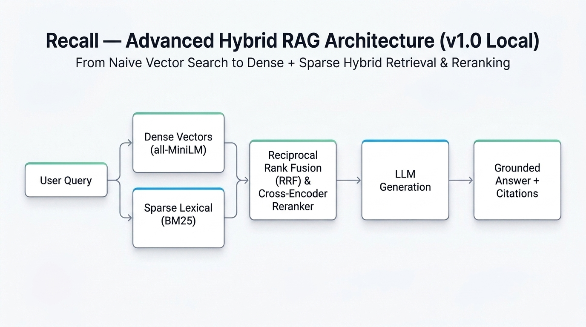

# Recall

A privacy-focused local RAG assistant that indexes Obsidian Markdown vaults, retrieves relevant notes using dense + sparse hybrid search and cross-encoder reranking, and generates answers with heading-level citations.



---

## The Journey: From Naive RAG to Advanced Retrieval

Recall started as a standard "naive RAG" prototype: read Markdown files, split text into chunks, generate dense vector embeddings, store them in Qdrant, and retrieve context via cosine similarity.

Testing on a real, multi-topic personal knowledge vault quickly revealed where naive RAG breaks down:

- **The Keyword Needle Failure:** Dense bi-encoders compress several hundred words into a single vector. Exact keywords, environment variables, acronyms, or specific dates get diluted by the surrounding text and fail to rank in the top results.
- **Score Scale Conflicts:** You cannot simply add a dense cosine score (bounded between -1 and 1) to a sparse BM25 score (unbounded). Their distributions are mathematically incompatible.
- **Top-K Ranking Gaps:** Relevant evidence often lands in the top 15 candidates, but sits at rank #4 or #5—diluting the LLM's attention when assembling prompt context.

To solve these failure modes, Recall evolved into an **Advanced Hybrid RAG** system:

1. **Deterministic Scoped Routing:** If a query explicitly references a note or heading (e.g. `What is in the Launch section of WEEKLY GOALS.md?`), Recall parses the intent and deterministically retrieves the exact file/heading chunks in reading order—bypassing vector search entirely.
2. **Dense + Sparse Hybrid Search:** Queries without explicit references search two parallel streams:
   - **Dense Semantic Retrieval:** Powered by `sentence-transformers/all-MiniLM-L6-v2` in Qdrant.
   - **Sparse Lexical Retrieval:** Powered by an in-memory BM25 Okapi index that captures exact token matches.
3. **Reciprocal Rank Fusion (RRF):** Fuses dense and sparse candidate streams using rank positions ($k=60$) rather than raw scores, eliminating score-scale incompatibility.
4. **Two-Stage Cross-Encoder Reranking:** Takes the fused candidate pool and scores query-chunk pairs using `cross-encoder/ms-marco-MiniLM-L-6-v2`. Full cross-attention between the query and chunk promotes the most relevant context to rank #1—executing on CPU in under 30ms.
5. **Grounded Generation with Citations:** Passes the reranked evidence to Gemini Flash, producing structured answers linked to source file paths and Markdown heading hierarchies.

---

## Systematic Evaluation

Rather than evaluating on "vibes" or manual spot-checks, Recall includes a repeatable offline benchmark suite:

- **20 Curated Evaluation Queries:** Covering scoped whole-file, scoped headings, keyword needles, semantic concepts, paraphrased questions, multi-note synthesis, and unanswerable edge cases.
- **Hard Metrics:** Tracks **Recall@k**, **Mean Reciprocal Rank (MRR)**, and category-level performance.
- **Measured Progression:** Reranking and hybrid retrieval improved overall retrieval MRR from 0.804 (baseline dense) to 0.854 (+5.0%), boosting semantic top-rank accuracy to 100%.
- **Test Suite:** 130 passing unit and integration tests covering chunking, scoped routing, BM25 indexing, RRF mathematics, and API endpoints.

---

## Tech Stack

| Component | Technology | Role |
| :--- | :--- | :--- |
| **API Backend** | FastAPI, Python 3.12, Pydantic | Query routing, RAG orchestration, session state |
| **Vector Database** | Qdrant (Docker) | Isolated collections per vault, cosine similarity |
| **Dense Embeddings** | `sentence-transformers/all-MiniLM-L6-v2` | 384-dimensional local CPU embeddings |
| **Sparse Index** | In-Memory BM25 Okapi | Fast lexical retrieval with automatic cache invalidation |
| **Reranker** | `cross-encoder/ms-marco-MiniLM-L-6-v2` | Two-stage candidate reranking on CPU |
| **Answer Synthesis** | Google Gemini (`gemini-2.5-flash` via LangChain) | Grounded response generation with citations |
| **Frontend UI** | React, Vite | Vault selector, ingestion status, grounded chat transcript |

---

## Getting Started

### Prerequisites
- Python 3.12+ with [`uv`](https://docs.astral.sh/uv/) installed
- [Docker Desktop](https://www.docker.com/) (for Qdrant)
- Node.js 18+ (for frontend)
- A Google Gemini API Key

### 1. Clone & Configure Environment
```bash
git clone https://github.com/your-username/recall-rag.git
cd recall-rag
cp .env.example .env
```
Add your Gemini API key in `.env`:
```env
GEMINI_API_KEY=your_gemini_api_key_here
```

### 2. Start Qdrant
```bash
docker compose up -d
```
Verify Qdrant is running at `http://localhost:6333/dashboard`.

### 3. Install Dependencies & Start Backend
```bash
uv sync --all-groups
uv run uvicorn app.main:app --reload
```
The FastAPI backend will be available at `http://localhost:8000` (docs at `/docs`).

### 4. Start the Frontend
In a separate terminal:
```bash
cd frontend
npm install
npm run dev
```
Open `http://localhost:5173`, connect your vault folder, click **Ingest vault**, and start chatting with your notes!

---

## Running Tests & Benchmarks

Run the full automated test suite:
```bash
uv run pytest -q
```

Run the retrieval evaluation benchmark:
```bash
# Baseline dense retrieval
uv run python eval/run_retrieval_eval.py

# Dense + Cross-Encoder Reranking
uv run python eval/run_retrieval_eval.py --rerank

# Full Hybrid (Dense + BM25 via RRF) + Cross-Encoder Reranking
uv run python eval/run_retrieval_eval.py --hybrid --rerank
```

Run linter checks:
```bash
uv run ruff check app eval tests
```

---

## Privacy by Design

- Markdown notes, chunk embeddings, and the Qdrant database run 100% locally on your machine.
- Your personal vault directory (`vault/`) and `.env` are excluded from Git.
- Only the specific retrieved context chunks needed to answer a user prompt are sent to the LLM during chat generation.
